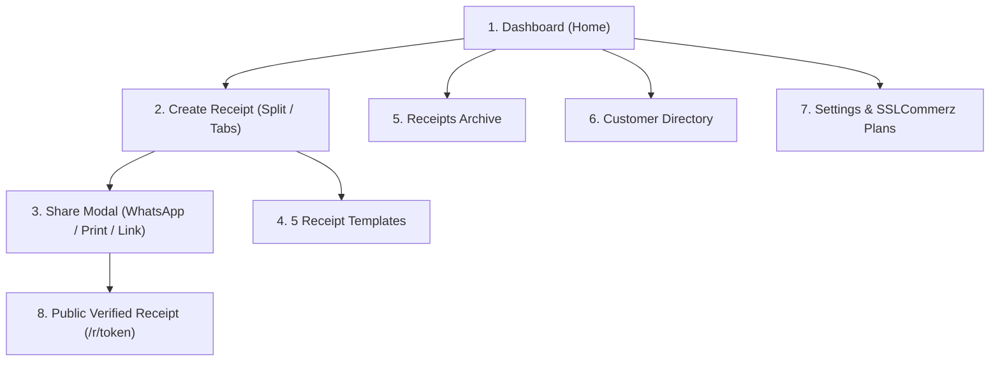

# 🎨 UI/UX Design Specification & Handoff Guide
**Project:** Payment Receipt SaaS (*ReceiptKoro*)  
**Platform:** Responsive Web App / PWA (Mobile-First 390px, Desktop 1280px+)  
**Primary Market:** Bangladesh (SME shops, F-Commerce, freelancers), then Global  
**Core Objective:** Enable merchants to create branded receipts, send them via WhatsApp/Email/SMS, and track revenue in **under 30 seconds**.

---

## 1. Product Summary & Target Personas

### Target Users
1. **F-Commerce Page Owners (Facebook/Instagram Sellers)**: Selling clothing, cosmetics, gadgets. Need quick receipts to send on WhatsApp/Messenger right after customer bKash/Nagad payment.
2. **Local Retail & Specialty Shops**: Electronics, mobile repair, pharmacies, grocery stores. Need fast 58mm/80mm thermal paper receipts or digital PDF vouchers.
3. **Freelancers & Service Providers**: IT consultants, agency owners, photographers. Need professional formal PDF invoices with tax, discounts, and online verification.

### Design Principles
- **Speed & Frictionless**: 1-handed mobile input; generating a complete receipt must take under 30 seconds.
- **Bangla-Native & Culturally Familiar**: Built with Bangladeshi payment methods (bKash, Nagad, Rocket) and authentic Bengali invoice terms ("চালান", "ক্যাশ মেমো", "কথায়").
- **Financial Trust & Legitimacy**: Clean typographic hierarchy, verified cryptographic QR stamps, and crisp borders that convey official authenticity.

---

## 2. Design System & Style Tokens

### 2.1 Color Palette

| Token Name | Hex Code | Usage | Meaning / Psychological Impact |
|---|---|---|---|
| **Emerald Primary** | `#059669` | Primary CTA, active states, brand headers | Trust, financial security, prosperity |
| **Emerald Deep** | `#064E3B` | Dark gradients, modal headers, dark text accents | Professionalism, stability |
| **Mint Accent** | `#10B981` | Success badges, checkmarks, highlights | Positive confirmation, paid status |
| **Mint Light** | `#ECFDF5` | Tag backgrounds, subtle callouts | Soft breathing room |
| **Slate Dark (Ink)** | `#0F172A` | Primary typography, dark buttons | Crisp legibility |
| **Slate Body** | `#475569` | Secondary text, descriptions | Reduced eye strain |
| **Slate Muted** | `#94A3B8` | Placeholders, inactive icons, table headers | Low visual noise |
| **Background** | `#F8FAFC` | App canvas background | Clean modern SaaS feel |
| **Surface White** | `#FFFFFF` | Cards, modals, receipt paper | Pure contrast |
| **Border Line** | `#E2E8F0` | Card borders, dividers, inputs | Subtle structure |

#### Payment Method Identity Colors (Essential for BD Market)
- **bKash Pink**: `#E2136E` (Badge bg: `#FCE7F3`, Text: `#BE185D`)
- **Nagad Orange**: `#F7941D` (Badge bg: `#FEF3C7`, Text: `#B45309`)
- **Rocket Purple**: `#8C3494` (Badge bg: `#F3E8FF`, Text: `#7E22CE`)
- **Cash / Green**: `#16A34A` (Badge bg: `#DCFCE7`, Text: `#15803D`)
- **Bank Card / Blue**: `#2563EB` (Badge bg: `#DBEAFE`, Text: `#1D4ED8`)

---

### 2.2 Typography System

- **English Font Family**: `Inter` or `Plus Jakarta Sans`
- **Bengali Font Family**: `Noto Sans Bengali` or `Hind Siliguri`
- **Monospace (Prices, TrxID, Receipt #)**: `JetBrains Mono`, `SFMono`, or standard tabular numbers.

```
Display Large:   32px / 38px line-height (Bold 700)
Heading 1:       24px / 30px line-height (Bold 700)
Heading 2:       18px / 24px line-height (SemiBold 600)
Body Regular:    14px / 20px line-height (Regular 400 & Medium 500)
Body Small:      12px / 16px line-height (Regular 400 & SemiBold 600)
Micro / Tags:    10px / 14px line-height (Bold 700, Uppercase tracking +0.5px)
Price Large:     22px / 26px line-height (ExtraBold 800, Tabular numbers)
```

> [!NOTE]
> **South Asian Currency Formatting Rule**:
> For BDT (৳), commas follow the 3-2-2 system (lakh/crore): `৳ 1,23,456.00`.
> In Bengali mode, Bengali numerals must be supported: `৳ ১২,৩৪,৫৬৭.০০`.

---

### 2.3 Component Geometry & Spacing
- **Base Grid**: 8pt system (4px, 8px, 12px, 16px, 20px, 24px, 32px, 48px).
- **Corner Radius**:
  - `rounded-3xl` (24px) for major cards and modals.
  - `rounded-2xl` (16px) for inner containers, KPI cards, and receipt containers.
  - `rounded-xl` (12px) for form inputs, primary buttons, and dropdowns.
  - `rounded-full` (9999px) for status badges, language toggle, and floating buttons.
- **Shadows**:
  - Soft Card: `0 1px 3px rgba(15, 23, 42, 0.05), 0 10px 25px -5px rgba(5, 150, 105, 0.06)`
  - Elevated Modal: `0 20px 40px -10px rgba(15, 23, 42, 0.2)`
  - WhatsApp Floating Glow: `0 8px 20px -4px rgba(37, 211, 102, 0.35)`

---

## 3. Screen-by-Screen UI/UX Specifications



---

### Screen 1: Mobile App Shell & Navigation
- **Top Sticky App Bar**:
  - Left: Logo icon (Emerald gradient rounded square with receipt glyph) + "Payment Receipt" brand text.
  - Center/Left: Merchant name pill (e.g. `Bengal Digital Solutions` with green status dot). Clicking opens the Business Profile drawer.
  - Right: Language switcher pill (`🇧🇩 বাংলা` / `🇬🇧 EN`).
- **Bottom Navigation Bar (Mobile)**:
  - 5 Navigation Items:
    1. **Home**: Dashboard icon
    2. **Receipts**: Receipt document icon
    3. **Create (+)**: Elevated floating circular button in center (`48x48px`, Emerald gradient with glowing drop shadow)
    4. **Customers**: Two-users icon
    5. **Settings**: Gear icon

---

### Screen 2: Dashboard (Overview & Analytics)
- **Store Banner / Welcome Card**:
  - Emerald gradient (`from-emerald-800 via-emerald-700 to-teal-900`) with subtle organic background blur shapes.
  - Displays merchant name, slogan, and high-contrast "+ Create Receipt" white button.
- **4 Key Financial KPI Cards (2x2 Grid on Mobile, 4x1 on Desktop)**:
  1. *Today's Sales* (`৳ 43,820.00` - Green trend label)
  2. *Total Lifetime Processed* (`৳ 1,28,270.00`)
  3. *Receipts Issued* (Count with "Active vouchers" label)
  4. *Total Customers* (Count in CRM)
- **Recent Receipts Section**:
  - Search bar with instant debounced search.
  - Filter pills: `[All]` `[Paid]` `[Unpaid]` `[Void]`.
  - Receipt card / table rows:
    - Receipt # (e.g., `RCP-2026-0001` in monospace).
    - Customer Name & phone number.
    - Date of issue.
    - Payment badge (bKash, Nagad, Rocket, Cash).
    - Formatted Total.
    - Quick action icons: [👁 Preview], [↗ Share], [Void].

---

### Screen 3: Receipt Creator / Generator (`/new`)
- **Mobile Segmented Control (Top)**:
  - `[1. Edit Details]` | `[2. Live Preview]`
  - On desktop: Displays 2-column side-by-side view (Form on left 60%, Sticky live preview on right 40%).
- **Section A: Template Carousel**:
  - 5 interactive cards allowing the user to tap and instantly see the live receipt restyled:
    1. `Modern Emerald`
    2. `বাংলা মেমো (Bangla First)`
    3. `Classic Formal`
    4. `Clean Minimalist`
    5. `58mm Thermal POS`
- **Section B: Customer Auto-fill**:
  - Dropdown: `[+ Pick Existing Customer]` or inline typing.
  - Inputs: Name (Required), Phone / WhatsApp, Email, Address.
- **Section C: Dynamic Line Items**:
  - Row item card: Description, Qty, Unit Price, Line Total.
  - Tax/VAT selector: 0%, 5%, 7.5%, 15%.
  - Actions: Delete row button, `+ Add Line Item` dashed border button.
- **Section D: Payment Method Selector**:
  - Grid of styled button chips with official brand colors:
    `[bKash]` `[Nagad]` `[Rocket]` `[Cash]` `[Bank Card]` `[Bank Transfer]`.
  - Payment Status toggle: `[Paid]` `[Partial]` `[Unpaid]`.
  - Transaction ID / TrxID field with monospaced uppercase styling.
- **Section E: Discounts & Shipping**:
  - Discount input with flat `[৳]` or `[%]` toggle button.
  - Delivery charge input.
- **Section F: Notes & Terms**:
  - Warranty remarks, return policy, and signature presets.
- **Sticky Bottom Action**:
  - High-visibility full-width emerald CTA: `[ ✓ Save & View Generated Receipt ]`.

---

### Screen 4: The 5 Receipt Voucher Templates (Crucial Deliverable)

The designer must provide 5 distinct visual designs for the receipt voucher canvas:

#### Template 1: Modern Emerald (Flagship)
- **Header**: Gradient emerald banner with curved top corners, white typography, store logo, and receipt number in a frosted glass badge.
- **Body**: Clean 2-column grid for Merchant vs. Customer info.
- **Table**: Soft mint striped table header, crisp dividers, bold totals.
- **Footer**: Integrated digital verification block featuring a QR code, token hash, warranty text, and "Made with Payment Receipt" micro badge.

#### Template 2: বাংলা মেমো / ভাউচার (Bangla First)
- **Aesthetic**: Traditional Bangladeshi business cash memo.
- **Header**: "ক্যাশ মেমো / মানি রিসিট" pill badge, large bold Bengali store name, phone and BIN numbers.
- **Labels in Bengali**:
  - "রশিদ নং", "তারিখ", "গ্রাহকের নাম", "পেমেন্ট মাধ্যম", "ক্রমিক", "পণ্যের বিবরণ", "পরিমাণ", "দর", "মোট টাকা", "ছাড়", "ভ্যাট", "সর্বমোট", "কর্তৃপক্ষের স্বাক্ষর".
- **Numerals**: Displays amounts using Bengali digits (`০১২৩৪৫৬৭৮৯`).
- **Signature Box**: Formal bottom line labeled "কর্তৃপক্ষের স্বাক্ষর" (Authorized Signature).

#### Template 3: Classic Formal
- **Aesthetic**: Corporate executive invoice.
- **Borders**: Double-line formal outer border (`4px double #334155`).
- **Header**: Centered uppercase serif/sans branding with "OFFICIAL PAYMENT RECEIPT" subtitle.
- **Table**: Full grid borders, item numbering column (`#`), formal subtotal/tax/total breakdown.
- **Signatures**: Dual signature lines: "Customer Signature" and "Authorized Signatory".

#### Template 4: Clean Minimalist
- **Aesthetic**: Scandinavian / Swiss modern invoice.
- **Layout**: High negative space, zero heavy background blocks.
- **Borders**: Hairline dividers (`1px solid #F1F5F9`).
- **Typography**: Light & regular weights, micro uppercase labels (`RECEIVED FROM`, `SETTLED WITH`).
- **QR Code**: Small, sleek, borderless QR code in bottom-left.

#### Template 5: 58mm / 80mm Thermal POS Roll
- **Aesthetic**: Real thermal cash register slip.
- **Typography**: Strict monospaced typography (`Courier` / `JetBrains Mono`).
- **Separators**: Dashed divider lines:
  ```
  ========================================
             BENGAL GADGET SHOP
            House #42, Road #11
          Phone: +880 1711-000000
  ----------------------------------------
  RC#: RCP-2026-0001           26-Nov-2026
  Cust: Tanvir Hossain              bKash
  ----------------------------------------
  ITEM                 QTY         TOTAL
  MacBook Charger       1       11,500.00
  MX Master 3S Mouse    1       13,500.00
  ----------------------------------------
  SUBTOTAL:                     25,000.00
  DISCOUNT:                     -1,000.00
  VAT (5%):                      1,200.00
  DELIVERY:                        120.00
  ----------------------------------------
  TOTAL:                      ৳ 25,320.00
  PAID (bKash):               ৳ 25,320.00
  ========================================
           [ QR CODE VERIFICATION ]
           Token: a8e9f142b7890cd1e4
          *** Thank you, visit again ***
  ```

---

### Screen 5: Share & Delivery Action Modal
- Modal triggered immediately when a receipt is saved:
  1. **Primary Button (WhatsApp)**: Bright WhatsApp green (`#25D366`), phone icon, subtext: *"1-Click click-to-chat with pre-filled message"*.
  2. **Secondary Button (Print / PDF)**: Dark button (`#0F172A`) with printer icon, subtext: *"Optimized for thermal roll & A4 printers"*.
  3. **Tertiary Button (Email)**: Light grey pill button with mail icon.
  4. **Shareable Link Box**: Readonly URL field with 1-click `[ Copy Link ]` button showing checkmark animation.

---

### Screen 6: Public Receipt Verification Page (`/r/[token]`)
- Screen displayed when a customer taps the WhatsApp link or scans the QR code:
  - Clean, distraction-free view without administrative controls.
  - Floating top banner:
    - Left: Green shield icon + "Verified Authentic Payment Receipt".
    - Right: `[ 🖨️ Print / Download PDF ]` button.
  - Shows the complete rendered receipt.
  - Footer: "🔒 Cryptographically signed by merchant token • Powered by Payment Receipt".

---

### Screen 7: Customer Directory (CRM)
- Search bar for quick name/phone lookups.
- `+ Add Customer` modal (Name, Phone, Email, Address).
- Customer cards:
  - Avatar or initial badge.
  - Name and contact numbers.
  - Lifetime total purchase volume (`৳ 82,000.00`).
  - Total receipt count badge (`3 receipts`).

---

### Screen 8: Settings & Subscription Billing
- **Business Profile Section**:
  - Logo upload preview, store name, phone, address, BIN/TIN number, receipt prefix customizer (`RCP`).
- **Subscription Comparison Cards**:
  - **Free Tier** (`৳০ / month`): 30 receipts/mo, watermark included, standard templates.
  - **Pro Tier** (`৳২৯৯ / month`): Unlimited receipts, remove watermark, all 5 templates, 100 SMS notifications/mo, Gemini AI OCR receipt scanner.
  - Payment integration logos: bKash, Nagad, Rocket, Visa/Mastercard via SSLCommerz.

---

## 4. Micro-Interactions & UX Details

1. **Auto-Calculations**:
   As the user types quantity, unit price, discount, or tax, subtotal and totals must animate with tabular figures without page lag.
2. **Keyboard Handling on Mobile**:
   Numeric inputs (Quantity, Unit Price, Phone, Discount) must trigger the `decimal` or `tel` keyboard on iOS and Android.
3. **Empty States**:
   Pleasant illustration or icon when no receipts exist: *"No receipts found. Create your first receipt in 30 seconds."*
4. **Touch Target Size**:
   All buttons, chips, and dropdowns must have a minimum touch boundary of **48 x 48px** for easy thumb operation.
5. **Print Stylesheet (`@media print`)**:
   Receipt cards must have zero margins, no background canvas, and 100% black text contrast when printed on physical POS or laser printers.

---

## 5. Designer Checklist (What to Hand Over in Figma)

- [ ] **Figma Design Tokens**: Colors, Typography styles, Spacings, Radius, and Drop Shadows.
- [ ] **Mobile Mockups (390px width - iPhone 14/15/16)**:
  - Dashboard Home
  - Receipt Creator (Form Tab & Preview Tab)
  - Share Modal
  - Public Verification View
  - Customer Directory
  - Settings & Plans
- [ ] **Desktop Views (1280px / 1440px)**:
  - Side-by-side Creator (Form on left, live sticky preview on right).
  - Dashboard with expanded data table.
- [ ] **5 Vector Receipt Layouts**:
  - Modern Emerald
  - Bangla First
  - Classic Formal
  - Clean Minimalist
  - 58mm Thermal Slip
- [ ] **Icon Set & Assets**:
  - SVG icons for payment methods (bKash, Nagad, Rocket).
  - UI navigation icons (Receipt, Customer, Settings, WhatsApp, Share, Print).
  - Brand Logo lockups (Light, Dark, App Icon).
