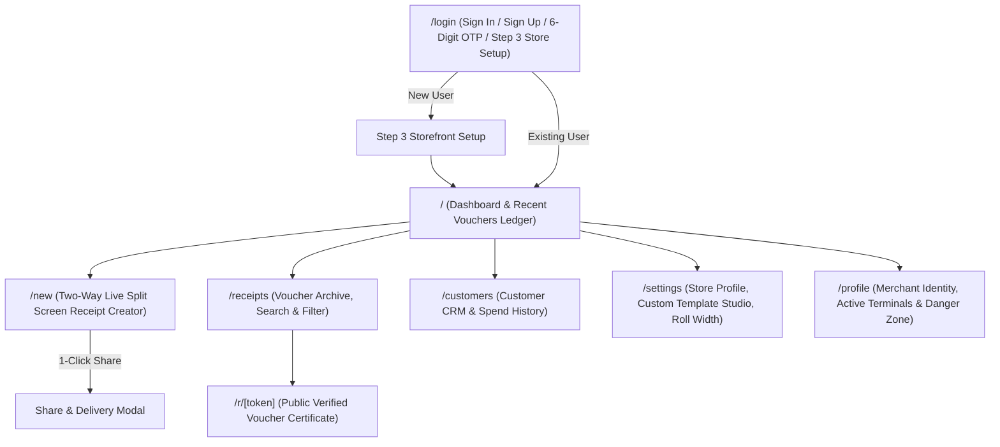

# SlipDo — Complete UI/UX Design Handoff Specification

**Product Name:** SlipDo  
**Product Category:** Smart Digital Receipts, Cash Memos & Invoicing SaaS  
**Target Market:** Small-to-medium merchants in Bangladesh (F-Commerce, Retail Outlets, Super-shops, Gadget Stores, Pharmacies, Restaurants, and Freelancers)  
**Primary Platforms:** Mobile-First Web Application (PWA) + Desktop Browser Responsive  
**Viewport Benchmarks:**
- Mobile: 390px × 844px (iPhone 14/15/16 baseline & common Android screens)
- Tablet: 768px × 1024px
- Desktop: 1280px / 1440px max-width container

---

## 1. Brand Identity & Design System Tokens

### 1.1 Color Palette
- **Primary Brand (Emerald):**
  - Dark: `#065F46` / `#047857`
  - Base: `#059669` (Core CTA, success states, emerald template)
  - Light Accent: `#D1FAE5` / `#ECFDF5`
- **Secondary Brand (Cobalt / Tech Blue):**
  - Base: `#2563EB` / `#3B82F6` (Buttons, active states, links)
  - Light: `#EFF6FF`
- **Merchant Slate (Neutral Backgrounds & Text):**
  - Background Body: `#F8FAFC`
  - Card Surfaces: `#FFFFFF`
  - Border Subdued: `#E2E8F0` / `#CBD5E1`
  - Text Primary (Ink): `#0F172A` / `#1E293B`
  - Text Secondary (Muted): `#64748B`
- **Local Bangladesh Payment Gateways (Mandatory Brand Badges):**
  - **bKash Pink:** `#E2136E` (Background: `#FDF2F8`, Border: `#FBCFE8`)
  - **Nagad Orange:** `#F7941D` (Background: `#FFF7ED`, Border: `#FED7AA`)
  - **Rocket Purple:** `#8C3494` (Background: `#FAF5FF`, Border: `#F3E8FF`)
  - **Cash / Bank:** `#2563EB` (Background: `#EFF6FF`, Border: `#BFDBFE`)
- **Status Indicators:**
  - Paid: Emerald (`#059669`)
  - Due / Partial: Amber (`#D97706`)
  - Void / Cancelled: Rose (`#E11D48`)

### 1.2 Typography Hierarchy
- **Latin Font Family:** Inter (or Plus Jakarta Sans) — weights: 400, 500, 600, 700, 800
- **Bangla Font Family:** Hind Siliguri / Noto Sans Bengali — weights: 400, 500, 600, 700
- **Monospace Font Family:** JetBrains Mono — for Receipt Numbers (`SD-2026-1001`), BIN (`000123456-0101`), QR tokens, and monetary totals
- **Scale:**
  - Hero Titles: 24px - 32px (Bold / Extrabold)
  - Section Headers: 18px - 20px (Bold)
  - Card Titles & Table Headers: 13px - 14px (Semi-bold)
  - Body Text: 12px - 13px (Regular / Medium)
  - Micro-copy & Badges: 9px - 11px (Bold / Uppercase tracking)

### 1.3 Surface & Shape Language
- **Corner Radii:**
  - Standard Cards: `20px` to `24px` (`rounded-3xl`)
  - Buttons & Inputs: `9999px` (`rounded-full` pill design)
  - Micro Badges: `6px` to `8px` (`rounded-lg`)
- **Shadows:** Soft diffuse shadows (`0 10px 25px -5px rgba(0,0,0,0.04), 0 8px 10px -6px rgba(0,0,0,0.02)`)
- **Borders:** Thin slate hairline `1px solid #E2E8F0`

---

## 2. Complete Screen-by-Screen Architecture

---

### Screen 1: Authentication & Onboarding (`/login`)
- **Mode Toggle:** Pill segmented switch between "Sign In" and "Sign Up".
- **Fields (Sign In):**
  - Email address input with envelope icon.
  - Password input with toggle show/hide eye icon.
  - "Remember me" radio selector + "Forgot Password?" trigger.
  - Single primary action button: "Login".
  - Social Sign-In: "Log in with Google".
- **Fields (Sign Up):**
  - Email address, Password, Confirm Password.
  - Auto-sends 6-digit verification code.
- **OTP Screen Mode:**
  - 6 individual numeric boxes with auto-focus advance and backspace support.
  - Resend timer countdown (60s).
- **Step 3 Storefront Onboarding (Mandatory for First-Time Setup):**
  - Distinct header badge: "Outlet" + "Setup Your Storefront (Step 3 of 3)".
  - Store / Outlet Name (Required).
  - Business Category selector (Retail, Fashion, Gadgets, Pharmacy, Grocery, Restaurant, Services).
  - Contact Phone with Country Code dropdown (Default: Bangladesh `+880`).
  - Physical Outlet Address.
  - Currency selector (`BDT ৳`, `USD $`, `EUR €`, `INR ₹`) + BIN/VAT Number.
  - **Store Logo Upload:** Upload square/horizontal logo with live avatar thumbnail.
  - **Digital Signature Upload:** Upload PNG/JPEG signature or drawn graphic.
  - CTA Button: "Complete Setup & Launch Dashboard".

---

### Screen 2: Merchant Dashboard (`/`)
- **Navigation Bar:**
  - Brand lockup: SlipDo Logo + "PRO" badge.
  - Active Outlet Switcher: Thumbnail avatar of uploaded store logo + Store Name + dropdown arrow (triggers Business Drawer).
  - Language switcher: English / বাংলা.
  - Navigation tabs (Dashboard, Creator, Vouchers, Customers, Settings, Profile).
- **Hero Banner:**
  - Dark gradient background (Deep Blue to Slate).
  - Active outlet status badge with pulsing live dot.
  - Primary headline: "Fast Branded Receipts & Invoicing".
  - Quick action CTA button: "+ Create Receipt".
  - Tier upgrade button: "Upgrade Pro".
- **KPI Metrics Cards (Grid of 4):**
  1. **Today's Revenue:** Total sales volume for current date in BDT (`৳`).
  2. **Total Ledger Volume:** Cumulative volume across all non-void receipts.
  3. **Vouchers Issued:** Total count of receipts generated.
  4. **Active Customers:** Unique client count in registry.
- **Quick Action Triggers:**
  - Create 58mm Thermal Slip
  - Create A4 Tax Invoice
  - Add Customer
  - Scan Invoice (AI OCR)
- **Recent Receipts Ledger Table:**
  - Filter bar: Search by Receipt No, Customer Name, or Phone; Filter tabs: All, Paid, Due, Void.
  - Table Columns:
    - Receipt ID (`SD-2026-1001`) with issue timestamp.
    - Customer Name & Phone number.
    - Payment Method Badge (bKash, Nagad, Rocket, Cash).
    - Status Badge (Paid in Green, Due in Orange, Void in Red).
    - Total Amount (`৳1,250.00`).
    - Actions: Quick View, 1-Click WhatsApp Share, Print.

---

### Screen 3: Receipt Creator (`/new`)
- **Desktop Layout:** Two-column split layout (Left: Input Form Panel; Right: Sticky Live Receipt Preview).
- **Mobile Layout:** Segmented top pill toggle between `[Edit Details]` and `[Live Preview]`.
- **Form Controls (Left Panel):**
  - **Voucher Metadata Card:** Auto-generated Receipt Number (`SD-2026-XXXX`), Issue Date & Time, Payment Status (`Paid` / `Due`).
  - **Customer Details Card:** Customer Name, Country Code dropdown (Default: `+880`), Phone number.
  - **Line Items Table Builder:**
    - Item Description (Text input).
    - Quantity (Number stepper).
    - Unit Price (`৳`).
    - Computed Line Total.
    - "Add Item" button + Delete row trash icon.
  - **Taxes & Discounts Section:**
    - VAT/Tax toggle switch + tax rate percentage input.
    - Discount toggle switch + discount amount in BDT.
  - **Payment Method Selector:** Clickable visual badges for bKash, Nagad, Rocket, Cash, Card.
  - **Customer Remarks / Terms:** Text area for warranty notes, return policy, or "Thank you for shopping".
  - **Action Toolbar:** "Save & Preview", "1-Click WhatsApp Send", "Print Slip".

---

### Screen 4: Receipt Archive & Ledger (`/receipts`)
- **Header:** Title + Total active receipts count.
- **Search & Filter Controls:**
  - Real-time search bar (Customer, Phone, Receipt #).
  - Status pill tabs: All, Paid, Due, Void.
  - Date range filters.
- **Receipt Cards (Mobile) / Data Table (Desktop):**
  - Each item shows Receipt Number, Timestamp, Customer Info, Total, Status dropdown (allows inline status change from Due to Paid).
  - Quick action buttons: View, WhatsApp Share, Thermal Print.
- **Full Preview Modal:** Opens high-fidelity receipt modal with instant print triggers.

---

### Screen 5: Customer CRM (`/customers`)
- **Header:** Customer Directory count + "+ Add Customer" button.
- **Customer List Cards:**
  - Avatar initials circle with gradient background.
  - Customer Full Name + Contact Phone.
  - Spend Stats: Total Spent (`৳24,500`), Number of Vouchers Issued (`12 slips`), Last Visit timestamp.
  - 1-Click Action: Direct WhatsApp message button (`wa.me`).
  - Detail Drawer: Clicking customer shows all historical receipts linked to their phone number.

---

### Screen 6: Store Settings & Custom Template Studio (`/settings`)
- **Section 1: Storefront Profile:**
  - Edit Store Name, Business Category, Outlet Address, Phone (with `+880` selector), BIN/VAT.
  - Store Logo Uploader (Replace, Preview, Delete).
  - Authorized Digital Signature Uploader (File upload or live signature drawing canvas).
- **Section 2: Custom Template Studio (Interactive Theme Builder):**
  - Brand Primary Color Picker (Presets: Emerald, Sapphire, Violet, Amber, Ruby, Slate).
  - Header Layout Selector: Split (Modern default), Centered (Retail style), Minimal.
  - Font Style Selector: Sans-serif, Serif, Monospace, Bangla Traditional.
  - Visibility Toggles: Show Logo, Show Phone, Show Outlet Address, Show BIN, Show QR Code, Show Signature.
  - Custom Footer Note input.
  - Real-time preview card updating simultaneously.
- **Section 3: POS Thermal Printer Settings:**
  - Roll width selector: 58mm (Small pocket thermal) vs 80mm (Standard supermarket/POS printer).
- **Section 4: Danger Zone:**
  - "Delete Merchant Account" button triggering secure confirmation dialog.

---

### Screen 7: Merchant Profile & Security (`/profile`)
- **Merchant Header:** Initials avatar, owner name, email address, outlet phone.
- **Security & Active Sessions:**
  - List of active login terminals (Device name, IP location, last active timestamp, Revoke button).
- **Cache Management:** Sync offline cache button.
- **Danger Zone:** Delete Merchant Account button with verification prompt.

---

### Screen 8: Public Verified Voucher Certificate (`/r/[token]`)
- **Public URL Accessible by QR Code Scan:**
- **Verification Header:**
  - "Official Digital Receipt — Verified by SlipDo Anti-Tamper Engine".
  - Cryptographic verification badge with green checkmark.
- **Receipt Display:** Full vector receipt using merchant's chosen template.
- **Customer Actions:** Download PDF button, Print Thermal button.

---

## 3. The 5 Voucher Templates & Print Layout Rules

| Template Name | Aesthetic Style | Best Suited For | Key Visual Elements |
|---|---|---|---|
| **Modern Emerald** | Tech & Clean Fintech | Gadget stores, electronics, modern retail | Emerald gradient header, clean borders, prominent payment badge |
| **Traditional Cash Memo** | Authentic Bangladeshi Paper Memo | Wholesale, grocery, stationery, New Market shops | Classic framed border, Bangla header (ক্যাশ মেমো), itemized grid, signature seal |
| **Minimal Dark** | High-end Luxury & Monochromatic | Boutiques, fashion labels, jewelers | Sleek black-and-white lines, understated typography, clean spacing |
| **Thermal POS** | Thermal Paper Roll (58mm / 80mm) | Fast checkout, cafes, restaurants, pocket printers | Perforated zig-zag edges top and bottom, monospaced items, centered QR code |
| **Custom Merchant Studio** | Merchant-Defined Brand | Branded corporate outlets, established franchises | Merchant's exact brand color, chosen font, custom layout, toggleable fields |

### Print / PDF Layout Rules:
1. **Single-Page Constraint:** When a receipt contains standard item counts (1 to 6 items), it **must fit completely on 1 single page** without spilling onto a blank or trailing second page.
2. **Multi-Page Flow:** Only when items exceed standard length (e.g., 10+ items) should it gracefully flow into page 2 with table headers repeated.
3. **Thermal Printing Widths:**
   - 58mm: Max-width 380px, compact padding, centered QR code.
   - 80mm: Max-width 560px, standard tabular layout.
4. **Mandatory Elements on Every Voucher:**
   - Uploaded Store Logo (or clean store text header)
   - Store Name, Address, Contact Phone, and BIN
   - Unique Voucher Number + Issue Date
   - Customer Name & Phone
   - Line Items Table (Description, Qty, Price, Line Total)
   - Subtotal, Tax/VAT, Discount, Grand Total
   - Scannable QR Code linking to `https://slipdo.vercel.app/r/[token]`
   - Authorized Signature Block
   - Footer Warranty / Terms Note
